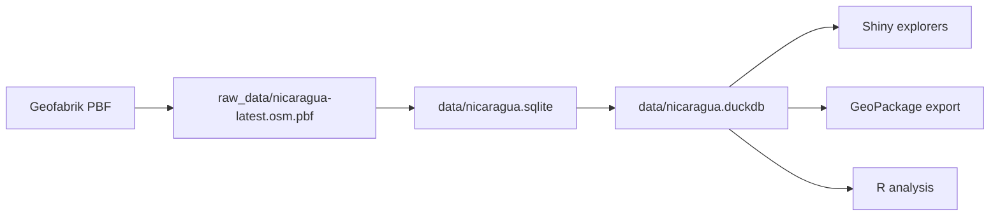

# OSM Nicaragua Data and Shiny Explorers

Local tools for downloading, importing, mapping, filtering, exporting, and
inspecting OpenStreetMap data for Nicaragua with R, DuckDB, and Shiny.

## Quick start

Run from the project root:

```r
install.packages(c(
  "shiny", "DBI", "duckdb", "sf", "leaflet", "curl", "jsonlite"
))

source("code/downloadOSMData.R")
download_osm_data()

source("code/importOSMData.R")
import_osm_data()

shiny::runApp("app.R")
```

Install GDAL/OGR before importing. On macOS with Homebrew:

```sh
brew install gdal
```

Install the required DuckDB extensions once:

```r
con <- DBI::dbConnect(duckdb::duckdb())
DBI::dbExecute(con, "INSTALL spatial;")
DBI::dbExecute(con, "INSTALL sqlite;")
DBI::dbDisconnect(con, shutdown = TRUE)
```

## Project layout

- [`app.R`](app.R): primary map, filter, export, and tag-summary app.
- [`geofabrik_downloader_app.R`](geofabrik_downloader_app.R): Geofabrik PBF
  catalog and download app.
- [`osm_db_explorer_app.R`](osm_db_explorer_app.R): DuckDB schema, table, and
  sample-row explorer.
- [`osm_tag_explorer_app.R`](osm_tag_explorer_app.R): standalone tag explorer.
- [`code/downloadOSMData.R`](code/downloadOSMData.R): atomic PBF download
  helper.
- [`code/importOSMData.R`](code/importOSMData.R): PBF-to-SQLite-to-DuckDB
  import pipeline.
- [`code/downloadTaginfodb.R`](code/downloadTaginfodb.R): optional Taginfo
  database downloader and converter.
- [`Nature_Reserves.R`](Nature_Reserves.R): example feature-selection and
  plotting analysis.
- [`SPECIFICATION.md`](SPECIFICATION.md): requirements, data contracts,
  limitations, and acceptance plan.

The primary application is `app.R`. This repository does not contain
`osm_plot_app.R` or `osm_logic_explorer_app.R`.

## Data flow



Downloaded and generated data are local artifacts:

- `raw_data/nicaragua-latest.osm.pbf`
- `data/nicaragua.sqlite`
- `data/nicaragua.duckdb`
- `data/taginfo-db.duckdb`

They are not required to be committed.

## Main application

```r
shiny::runApp("app.R")
```

The application:

- Opens `data/nicaragua.duckdb` read-only.
- Selects tables containing `WKT_GEOMETRY`.
- Filters direct columns, `other_tags`, or both.
- Supports case-insensitive contains and exact matching.
- Supports `AND`, `OR`, `&`, and `||` expressions.
- Maps point, line, and polygon WKT as EPSG:4326.
- Limits map-loaded rows from 100 through 100,000.
- Exports all matching rows to GeoPackage.
- Summarizes direct-column and sampled `other_tags` values.

`other_tags` summary counts may be incomplete because parsing is limited per
table. See the known limitations in
[`SPECIFICATION.md`](SPECIFICATION.md#11-known-limitations).

## Other applications

Geofabrik downloader:

```r
shiny::runApp("geofabrik_downloader_app.R")
```

Database explorer:

```r
shiny::runApp("osm_db_explorer_app.R")
```

Standalone tag explorer:

```r
shiny::runApp("osm_tag_explorer_app.R")
```

Optional Taginfo database:

```r
source("code/downloadTaginfodb.R")
```

## Helper arguments

`download_osm_data()` accepts:

- `project_dir`
- `source_url`
- `file_name`
- `progress_callback`

`import_osm_data()` accepts:

- `project_dir`
- `source_url`

Example:

```r
source("code/importOSMData.R")
import_osm_data(project_dir = "/path/to/OSM_Nic")
```

The importer always reads
`<project_dir>/raw_data/nicaragua-latest.osm.pbf`.

## Runtime requirements

Main application:

- R
- `shiny`
- `DBI`
- `duckdb`
- `sf`
- `leaflet`

Pipeline and auxiliary tools:

- GDAL/OGR `ogr2ogr`
- DuckDB `spatial` and `sqlite` extensions
- `curl` R package, optional for the download helper
- `jsonlite` and the `curl` command-line program for the downloader app
- `terra` and `ggplot2` for the example analysis

The recorded reference versions and platform are listed in
[`SPECIFICATION.md`](SPECIFICATION.md#5-runtime-compatibility). The project
does not yet provide an `renv.lock` or a multi-platform CI compatibility
matrix.

## Operational notes

- Run applications from the project root.
- Internet access is required for source downloads and online map tiles.
- Imports and generated databases may require substantial disk space.
- GeoPackage export loads all matching rows and may require substantial
  memory.
- The applications are intended for a single local user.
- Current implementation limitations and planned corrections are tracked in
  [`SPECIFICATION.md`](SPECIFICATION.md#11-known-limitations).

## License and OSM attribution

Project code is licensed under the
[`LICENSE`](LICENSE) terms.

OSM-derived data is governed by the OpenStreetMap Open Database License.
Interactive maps use OpenStreetMap Mapnik tiles with provider attribution.
When distributing generated databases, GeoPackages, or derivative works,
include appropriate OpenStreetMap attribution and comply with the ODbL.

See:

- <https://www.openstreetmap.org/copyright>
- <https://opendatacommons.org/licenses/odbl/>
